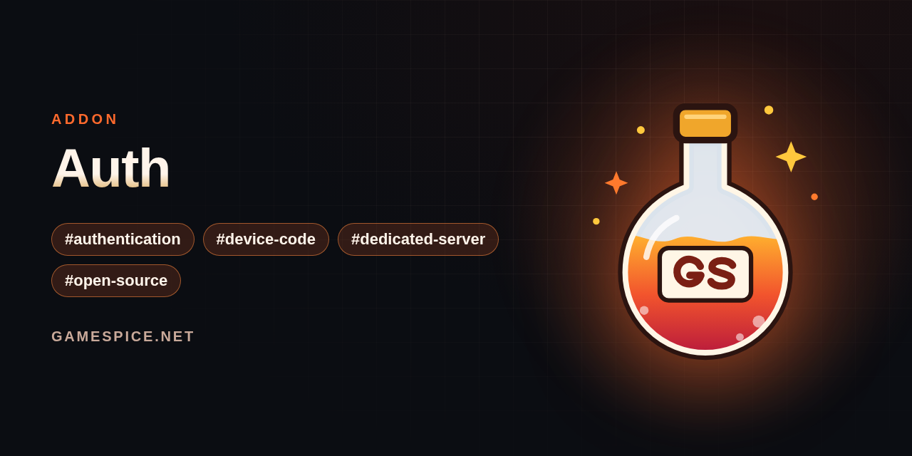

[](https://moddingcommunity.com/a/204-dot-auth)

Sign-in for Godot 4.7+ games and dedicated servers. A player signs in against a web back end, and a game server learns who they are without ever being handed a credential for their account. Part of the [dot-*](https://github.com/gamespice-platform) family, alongside [dot-core](https://github.com/gamespice-platform/core), [dot-server](https://github.com/gamespice-platform/server) and [dot-cloud](https://github.com/gamespice-platform/cloud).

## Install

1. Copy `addons/dot_core/` and `addons/dot_auth/` into your project.
2. Enable both in *Project > Project Settings > Plugins*.

## Client

```gdscript
var auth := DotAuthClient.new()
add_child(auth)
auth.config = DotAuthConfig.new()
auth.config.backbone_url = "https://moddingcommunity.com"
auth.config.client_name = "My Game"

auth.device_code_ready.connect(func(user_code, url, _expires):
    code_label.text = user_code      # for players on another device
    OS.shell_open(url))              # opens with the code pre-filled

var res := await auth.sign_in()
if res.ok:
    print("hello ", (res.value as DotAuthIdentity).display_name)
```

Sign-in uses a device code, so the password is only typed on the website, and the same flow works on desktop, mobile, console and in a browser. Returning players do not see a code: `sign_in()` restores the session from a stored refresh token.

## Server

```gdscript
var auth := DotAuthServer.new()
add_child(auth)
auth.config.strategy = DotAuthConfig.Strategy.TICKET
auth.config.server_id = "eu-west-1"
auth.config.ticket_public_key = ISSUER_PUBLIC_KEY

var res := await auth.authenticate({"ticket": ticket_from_client}, peer_address)
if not res.ok:
    reject(res.error.message)
    return
var identity: DotAuthIdentity = res.value
```

Tickets are checked offline, with no back-end request per join.

## Why tickets

A community server that receives a player's account token could act as that player on the whole site. Instead:

```
client --(device code + PKCE)--> back end         who am I
client --(access token)-------> DotAuthIssuer     publisher-run
client <-(signed ticket)------- DotAuthIssuer     one server, a few minutes
client --(ticket)-------------> game server       verified offline
```

A ticket is scoped to one server, short-lived, single-use and RSA-signed. A server can verify a ticket but cannot create one, and a ticket captured on one server is refused by all others. Only `DotAuthIssuer` needs the private key. See [docs/tickets.md](docs/tickets.md).

## Strategies

Set `config.strategy` to one of these.

| Strategy | Use for |
| --- | --- |
| `TICKET` | Public servers (the flow above). |
| `INTROSPECT` | First-party servers only. The client sends a single-use join token, and only to audiences in `first_party_audiences`. Warns at startup. See [docs/strategies.md](docs/strategies.md). |
| `LOCAL` | LAN and development. Accounts live in a JSON file. |
| `ANONYMOUS` | Everyone is a guest, so bans mean nothing. Warns at startup. |

Local profiles (below) work alongside any strategy.

## Local profiles (no cloud)

Not every game needs an identity service. With `allow_local_profiles` a visitor can create a profile that lives on that server only, and keeps it between visits.

```gdscript
# Server
config.allow_local_profiles = true
config.local_profiles_path = "user://profiles.json"
```

```gdscript
# Client: present what we hold for this server, or ask for a new profile.
var keeper := DotLocalProfileClient.at("user://local_profiles.dat")
keeper.open()

var credential := keeper.credential_for(server_id)
if credential.is_empty():
    credential = {"local_profile_new": {"name": chosen_name}}

# The server issues the secret once. Keep it, or the profile is lost.
keeper.remember(server_id, id, secret, name)
```

The server issues the credential. The client does not just claim a name, so typing someone else's name does not make you them. A machine id is deliberately not used, because it is client-supplied and empty on web and iOS. A server can accept back-end tickets and local profiles at the same time.

## Configuration

Defaults live in `cfg/addon/dot_auth/auth.yml`. A game overrides them in `cfg/game/<game>/dot_auth/`, and the server operator in `cfg/server/addon/dot_auth/` or `cfg/server/game/<game>/dot_auth/` (strongest). See [dot-core's addon-config.md](https://github.com/gamespice-platform/core/blob/main/docs/addon-config.md).

`DotAuthConfig.new().load_cfg()` reads these files, then `DOT_AUTH_*` environment variables and `--auth-*` command-line flags. Secrets (`issuer_private_key`, `integration_token`, `session_report_key`) are read from a file only, never from the environment or command line.

## Also included

| Class | What it does |
| --- | --- |
| `DotBackboneClient` | Reports a dedicated server's player count, map and roster to its site listing, with replay protection. |
| `DotAuthAdminSource` | Maps site groups, roles and claims to dot-server permission flags and immunity levels. Guests never get permissions, and site roles grant nothing unless you map them. |

## Try it

```bash
godot --headless --path . res://examples/auth_demo.tscn
godot --headless --path . res://examples/cfg_selftest.tscn
godot --headless --path . res://examples/session_reporter_selftest.tscn
```

The demo is an offline self-test. It exits non-zero on any failure. Run a ticket issuer with `res://examples/issuer.tscn`.

## Limits to know about

`DotAuthServer.hash_password` is salted SHA-256, not argon2, because Godot has no password KDF. It only keeps a LAN server from storing plaintext. Real accounts belong on the back end. On web, token-store encryption is obfuscation, because the key and the ciphertext share an origin. See [docs/security.md](docs/security.md#two-things-that-are-weaker-than-they-look).

## Status

Built and maintained with Claude Code. The test suites pass, but little of this has been in front of real players yet. Please report rough edges by opening an issue.

## Licence

MIT. See [LICENSE](LICENSE). Only the TMC back-end web infrastructure is not open source; if you use your own back end, you build that part yourself.
